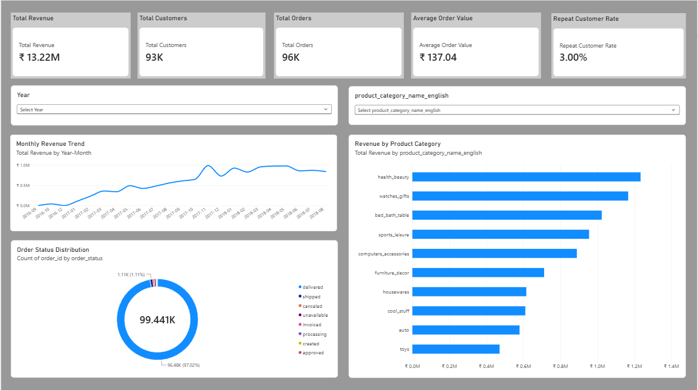
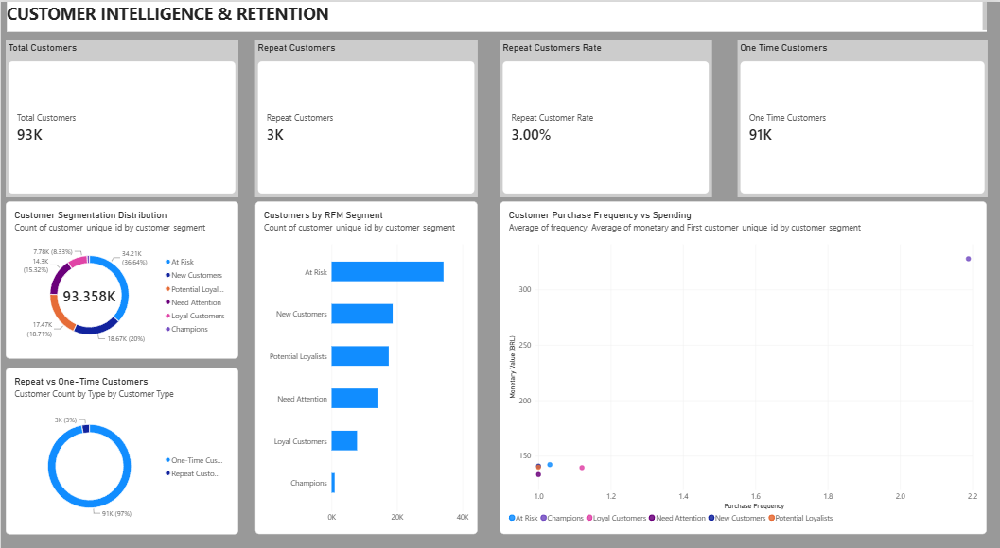
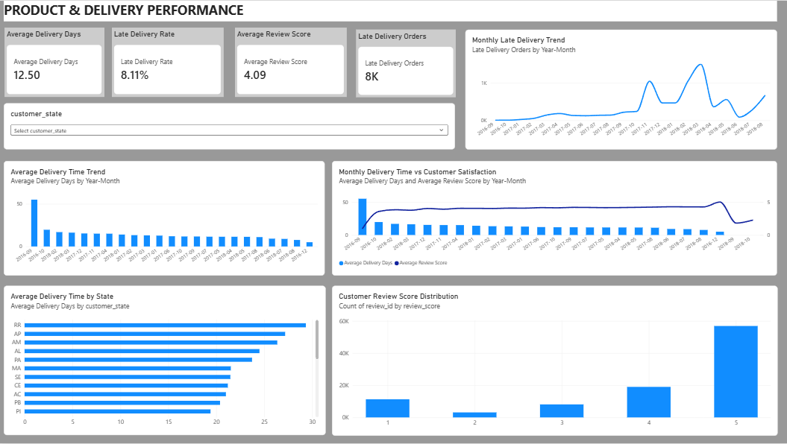

# E-Commerce Customer 360° Analytics & Intelligent Retention Strategy

An end-to-end data analytics project using Python, MySQL, and Power BI to analyse e-commerce performance, understand customer behaviour, identify retention opportunities, and improve business decision-making.

## Project Overview

This project uses the Brazilian Olist e-commerce dataset to build a Customer 360° analytics solution.

It combines data cleaning, exploratory data analysis, advanced SQL, RFM customer segmentation, cohort analysis, customer lifetime value analysis, churn-risk classification, and interactive Power BI dashboards.

## Business Objectives

- Analyse revenue and order performance.
- Identify top-performing product categories.
- Understand customer purchasing behaviour.
- Identify repeat and one-time customers.
- Segment customers using RFM analysis.
- Analyse customer retention and cohort behaviour.
- Evaluate delivery performance and customer satisfaction.
- Provide actionable business recommendations.

## Technology Stack

| Category | Tools |
|---|---|
| Programming | Python |
| Data Analysis | Pandas, NumPy |
| Visualization | Matplotlib, Seaborn |
| Database | MySQL |
| SQL | Joins, CTEs, Window Functions |
| Business Intelligence | Power BI, DAX |
| Version Control | Git, GitHub |

## Project Workflow

1. Business understanding and dataset acquisition
2. Data auditing and quality assessment
3. Data cleaning and preprocessing using Python
4. Exploratory Data Analysis (EDA)
5. Loading cleaned datasets into MySQL
6. Advanced SQL analysis
7. RFM customer segmentation
8. Cohort retention analysis
9. Customer Lifetime Value (CLV) analysis
10. Churn-risk classification
11. Power BI data modelling
12. DAX measure development
13. Interactive dashboard development
14. Business insights and recommendations

## Key Analysis Performed

### Python
- Missing-value and duplicate checks
- Data type validation
- Referential integrity checks
- Data cleaning and preprocessing
- Sales and customer behaviour analysis
- Delivery and review analysis

### MySQL
- Multi-table joins
- Common Table Expressions (CTEs)
- Window functions
- Ranking functions
- Month-over-month revenue analysis
- RFM segmentation
- Cohort retention analysis
- Customer value and churn-risk analysis

### Power BI
Three interactive dashboard pages were developed.

**1. Executive Overview**
- Total Revenue
- Total Orders
- Total Customers
- Average Order Value
- Repeat Customer Rate
- Monthly Revenue Trend
- Revenue by Product Category
- Order Status Distribution
- Year and Product Category slicers

**2. Customer Intelligence & Retention**
- Customer Segmentation Distribution
- Repeat vs One-Time Customers
- Customers by RFM Segment
- Purchase Frequency vs Spending

**3. Product & Delivery Performance**
- Average Delivery Days
- Late Delivery Orders
- Late Delivery Rate
- Average Review Score
- Monthly Delivery Performance
- Delivery Time by State
- Delivery Time vs Customer Satisfaction
- State slicer

## Dashboard Screenshots

### 1. Executive Overview


### 2. Customer Intelligence & Retention


### 3. Product & Delivery Performance


## Key Business Insights

- Approximately 13.22 million in delivered item revenue.
- Approximately 96,000 delivered orders.
- Approximately 93,000 unique customers.
- Repeat customer rate of approximately 3%.
- Health & Beauty was the highest-revenue product category.
- At Risk was the largest RFM customer segment.
- Average delivery time was approximately 12.5 days.
- Late delivery rate was approximately 8.11%.
- Average review score was 4.09 out of 5.
- Late deliveries showed a decreasing trend over time.

*Revenue and average order value are in the original dataset currency (BRL), not INR. Dashboard values are rounded.*

## Business Recommendations

1. Improve customer retention through loyalty programmes and personalized offers.
2. Target At Risk customers with re-engagement campaigns.
3. Prioritize high-performing product categories.
4. Investigate regional delivery delays and logistics efficiency.
5. Analyse negative reviews to improve customer experience.

## Repository Structure

```text
ecommerce-customer-360-analytics/
│
├── data/
│   ├── raw/
│   └── processed/
│
├── notebooks/
│   ├── 01_data_audit.py
│   ├── 02_data_cleaning.py
│   ├── 03_exploratory_data_analysis.py
│   └── 04_load_data_to_mysql.py
│
├── sql/
│   └── 05_advanced_sql_queries.sql
│
├── powerbi/
│   └── Ecommerce_Customer_360_Analytics.pbix
│
├── reports/
│   ├── figures/
│   └── business_insights_report.md
│
├── screenshots/
│
├── requirements.txt
├── .gitignore
└── README.md
```

## Dataset

**Source:** Brazilian E-Commerce Public Dataset by Olist (Kaggle).

The dataset contains information about customers, orders, payments, reviews, products, sellers, and geolocation.

Dataset files are not included in this repository. Refer to the original Kaggle dataset source to download them.

## Project Limitations

- RFM segmentation is rule-based.
- Churn-risk classification uses inactivity thresholds, not a trained predictive model.
- Revenue calculations use item prices and exclude freight.
- Historical trends should not be treated as guaranteed future outcomes.

## Future Improvements

- Machine-learning-based churn prediction
- Predictive Customer Lifetime Value
- Product recommendation system
- Automated reporting pipeline
- Additional customer cohort visualizations

## Author

**Data Analytics Portfolio Project**

Developed using Python, MySQL, and Power BI.